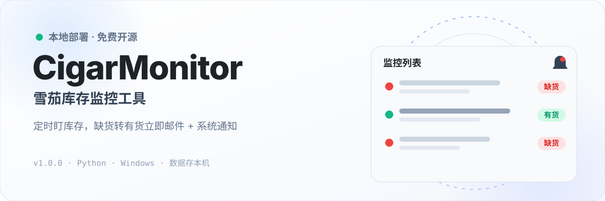
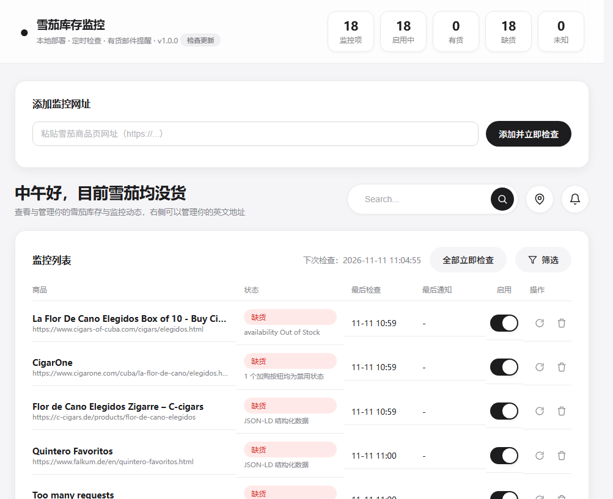
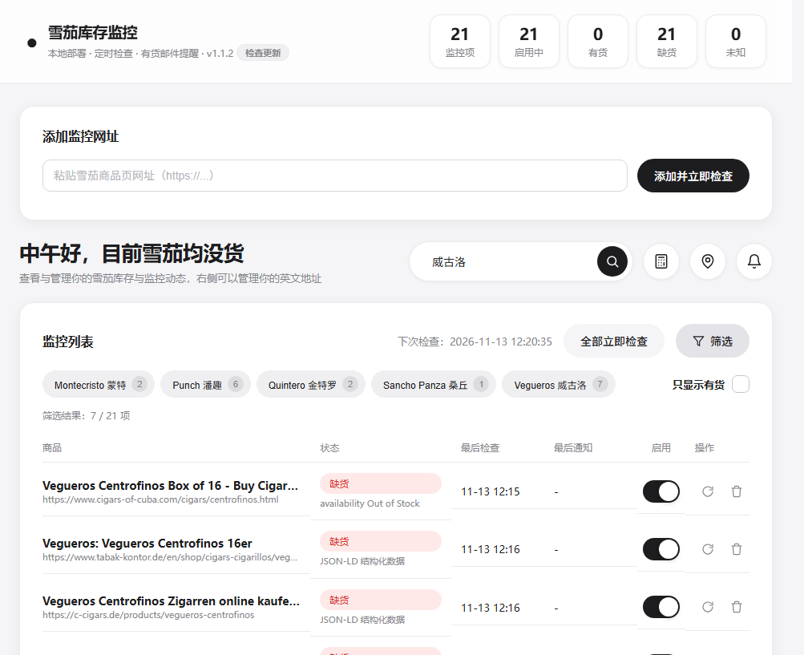
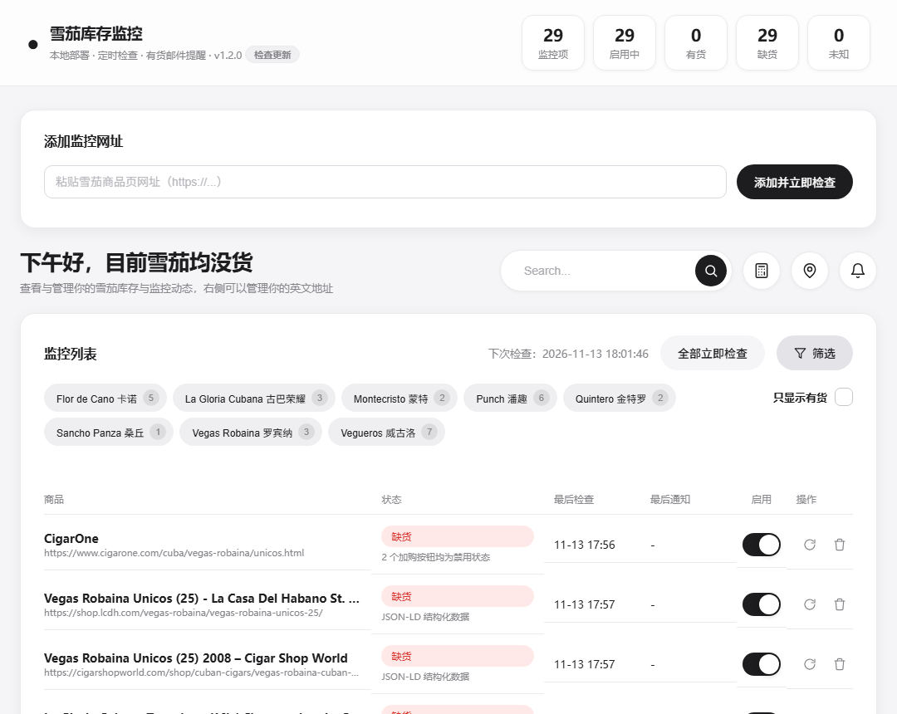
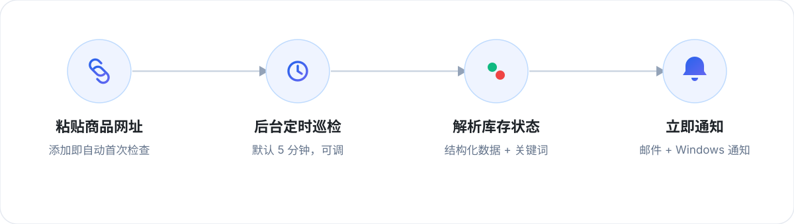

  

  
  
  
  

## 这是什么

CigarMonitor 是一个**本地部署的雪茄库存监控工具**：把商品页网址丢进去，它会在后台定时检查库存，一旦从「缺货」变成「有货」，立即发邮件并弹出 Windows 系统通知。全部数据保存在自己电脑上，无需公网服务器，也不向第三方上传数据。

提供桌面应用（推荐）与浏览器版两种使用方式。

## 界面预览

  

  

  

## 功能特性

- **定时巡检**：添加网址即自动识别商品名并完成首次检查，默认每 5 分钟轮询（界面可调，最小 30 秒）
- **有货提醒**：仅在「缺货 → 有货」时发一封邮件并弹 Windows 通知，不重复刷屏
- **中文搜索**：内置 34 个雪茄品牌的中英文词库，简称、全称都认；品牌标签在英文后标注中文
- **本地优先**：数据存本机 SQLite，关闭窗口即缩到托盘继续运行，不依赖公网服务器
- **自动更新**：后台静默检测新版本，一键自动下载、替换并重启，不影响本地数据
- **多邮箱预设**：QQ、163、126、Gmail、Outlook，另支持自定义 SMTP

## 工作原理

  

未知站点会先读取页面结构化库存数据（JSON-LD），再用多语言关键词（in stock / add to cart / ausverkauft / rupture de stock 等）兜底判断。

## 快速开始

### 桌面版（推荐）

1. 双击 `CigarMonitor.exe`（位于 `dist` 目录），稍候弹出原生窗口
2. 在「发信邮箱与监控设置」填入邮箱账号和 **SMTP 授权码**，保存后可点「发送测试邮件」
3. 顶部粘贴商品网址即可添加监控，列表默认空，由你自行添加

**系统托盘行为**：点关闭按钮（×）不会退出，窗口隐藏并转入后台继续监控；点击托盘图标恢复窗口，右键可选择「显示主窗口」或「退出」，只有托盘菜单的「退出」才会真正结束程序。

> 桌面版依赖 Microsoft Edge WebView2 运行时，Windows 10/11 通常已预装；若窗口无法打开，可在微软官网免费安装「Microsoft Edge WebView2 Runtime」。

### 浏览器版

1. 双击 `start.bat`（首次运行自动安装依赖）
2. 浏览器打开 `http://127.0.0.1:5050`，在设置区填入邮箱与授权码
3. 关闭命令行窗口即停止监控；保持窗口开着即可持续运行

## 邮箱授权码获取

- **QQ 邮箱**：网页版「设置 → 账号」开启「IMAP/SMTP 服务」，按提示验证后获得 16 位授权码（非登录密码）
- **163 / 126 邮箱**：网页版「设置 → POP3/SMTP/IMAP」开启 SMTP 并获取客户端授权码
- **Gmail**：开启两步验证后使用「应用专用密码」
- 选择对应预设后，SMTP 主机、端口、加密方式会自动填充，一般无需手动修改

## 支持站点与判断逻辑

| 站点 | 判断方式 |
|---|---|
| cigars-of-cuba.com | 页面 `stock-availability` 区块：Out of Stock / In Stock |
| cigarone.com | 加购按钮是否禁用（disabled = 缺货） |
| c-cigars.de | 结构化数据 schema.org/SoldOut 与 InStock |
| alpscigar.com | 模拟浏览器指纹绕过 Cloudflare，读取 WooCommerce 库存与结构化数据 |

其他网站直接粘贴网址即可，工具会自动按结构化数据 + 多语言关键词判断。

## 从源码构建

仓库不包含二进制文件（图标、exe、数据库均通过 `.gitignore` 排除）。

1. 安装依赖：`pip install -r requirements.txt`
2. 生成图标：`python make_icons.py`（有源图则从源图生成，无源图自动绘制「深色圆角底 + 金雪茄」默认图标）
3. 打包：直接运行 `build.bat`（缺图标时会先自动执行上一步）

首次启动默认不预置任何监控项；如需预置，可在 `seed/products.json` 中加入条目。

**开机自启**：按 `Win + R` 输入 `shell:startup`，把 `CigarMonitor.exe` 的快捷方式拖入启动文件夹即可后台静默运行。

## 数据与安全

- 浏览器版数据存于 `data/monitor.db`；桌面版存于 `%LOCALAPPDATA%\CigarMonitor\data\monitor.db`
- 邮箱授权码仅保存在本机，不上传任何第三方
- 公开仓库只含源码与纯文本种子，不含邮箱、授权码、地址、数据库、图标、exe 等个人数据或二进制资产
- 监控请求模拟普通浏览器访问，请合理设置检查频率，避免对目标站点造成压力

## 常见问题

- **测试邮件发不出去**：确认授权码正确、SMTP 服务已开启，主机/端口/加密保持对应预设
- **商品显示「未知」**：多为网络或反爬拦截，日志里有原因；Cloudflare 站点会自动重试，仍失败可降低检查频率
- **端口被占用**：桌面版会从 5050 起自动寻找可用端口，无需手动处理
- **自动更新**：仅在 exe 打包版生效，更新只替换程序本身，不会动数据库和设置，失败时静默跳过

## License

本项目基于 [MIT License](./LICENSE) 开源，可自由使用、修改与分发，请保留原始版权声明。
