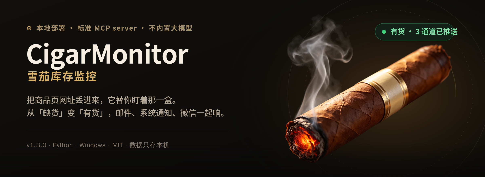
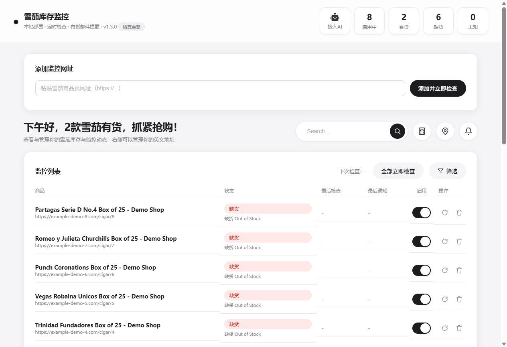
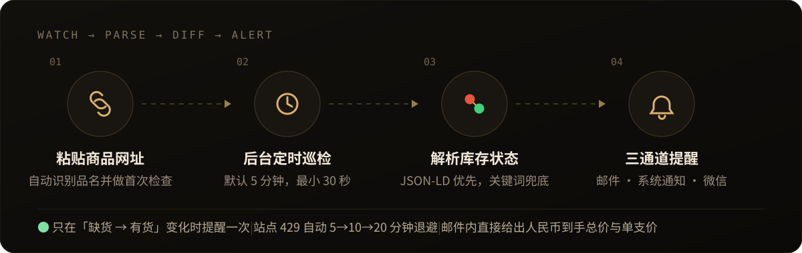

<p align="center">
  
</p>

<p align="center">
  
  
  
  
  
  <a href="https://m8ven.ai/mcp/hoho77777-cigar-monitor-1j3fyo?s=readme"></a>
</p>

**把商品页网址丢进去，它替你盯着那一盒。** 缺货转有货的那一刻，邮件、系统通知、微信同时响；邮件里已经算好人民币到手总价和单支价。数据全部留在自己电脑里，不经过第三方服务器。

[下载安装包](https://github.com/hoho77777/cigar-monitor/releases/latest) · [查看更新日志](https://github.com/hoho77777/cigar-monitor/releases)

## 界面预览

<table>
  <tr>
    <td width="33%"></td>
    <td width="33%"></td>
    <td width="33%"></td>
  </tr>
  <tr>
    <td align="center"><b>监控总览</b></td>
    <td align="center"><b>中文搜索</b></td>
    <td align="center"><b>品牌筛选</b></td>
  </tr>
</table>

> 截图为内置演示数据，公开仓库不包含任何真实监控记录。

## 这是什么

CigarMonitor 是一个 Windows / macOS 桌面应用，也是一个标准 MCP server。两种用法都在本地：

- **当监控工具用**：粘贴雪茄商品网址，后台按设定间隔轮询，库存状态发生变化时推送到三个通道。
- **当 AI 工具用**：软件在 `/mcp` 暴露 8 个工具，本机的 Claude、豆包、WorkBuddy、千问等可以直接查询库存、添加监控、算到手价。软件本身不内置也不打包任何大模型。

没有公网服务器，没有账号体系，关掉窗口就缩进托盘继续跑。

## 工作原理

<p align="center">
  
</p>

解析优先读页面的结构化数据（JSON-LD），读不到再用多语言关键词兜底（`in stock` / `add to cart` / `ausverkauft` / `rupture de stock` 等）；带 Cloudflare 防护的站点自动切换浏览器指纹抓取。个别模板把库存写在非标准字段（例如 osCommerce 系的 `Delivery time: available`），由站点适配器专门读取；遇到必须浏览器执行 JS 才能通过的人机验证，会明确提示无法抓取，而不是一直显示「未知」。价格同样先读 JSON-LD，再退回 `meta itemprop` 标记；一盒多少支从商品名的 `box of N` / `pack of N` / `N sticks` 里识别。

## 核心能力

**巡检与提醒**
- 添加网址即自动识别商品名并完成首次检查，默认每 5 分钟轮询，界面可调到最小 30 秒
- 只在「缺货 → 有货」时提醒一次，不重复刷屏；邮件、系统通知、微信 ClawBot 三通道同时送达
- 微信主动下发要求近 24 小时内和 bot 有过对话：窗口过期时提醒进补发队列，重新激活或点「发送测试微信」后自动补上，超过 24 小时放弃并记日志
- 站点返回 429 时按 5 → 10 → 20 分钟自动退避，不硬撞

**MCP 接入**
- 内置 `/mcp` 端点，8 个工具：软件状态、库存查询、添加监控、立即检查、启用/停用、删除监控、到手价计算、收货地址管理
- 「接入 AI」弹窗自动扫描本机已安装的助手（进程发现 + 多路径探测），一键写入 MCP 配置，可同时接入多个；不支持自动写入的提供分步引导与可复制提示词

**价格与品牌**
- 到手计算器支持 8 种货币，海关计征汇率取中国货币网官方中间价（每月更新），实时市场汇率自动获取并本地缓存，按 50% 烟草综合税率计算，断网回退缓存
- 邮件自动带入商品原价、人民币货值、预估税费、到手总价与到手单价；计税价超 ¥2,000 提示寄递限值与退运风险，税额 ≤¥50 提示可能免征
- 内置 67 个雪茄品牌中英文词库（Habanos 官方在售古巴品牌全部覆盖，另含 32 个非古巴厂牌），简称全称都认；三通道统一显示「英文（中文简称）」，首页单款有货只显示中文简称

**本地与维护**
- SQLite 存本机，关窗口转托盘继续监控，托盘菜单「退出」才真正结束进程
- 后台检测新版本，一键下载整包镜像替换并自动重启；用户数据在独立目录，更新不丢
- 多邮箱预设：QQ、163、126、Gmail、Outlook，另支持自定义 SMTP

## 快速开始

### 桌面版（推荐）

**Windows**

1. 到 [Releases](https://github.com/hoho77777/cigar-monitor/releases/latest) 下载 `CigarMonitor_v1.3.2_1_setup_windows.exe` 双击安装；免安装版 `CigarMonitor_v1.3.2_2_portable_windows.zip` 解压后，`CigarMonitor.exe` 与 `_internal` 必须保持同级
2. 打开 `CigarMonitor.exe`，在「发信邮箱与监控设置」填入邮箱账号与 **SMTP 授权码**，保存后点「发送测试邮件」验证
3. 需要微信推送就在下方扫码绑定 ClawBot
4. 顶部粘贴商品网址即可添加监控，列表默认为空，由你自行添加
5. 点「接入 AI」卡片，让本机 AI 助手一键接入，之后用对话就能查库存、加监控、算到手价

> 桌面版依赖 Microsoft Edge WebView2 运行时，Windows 10/11 通常已预装；窗口打不开时到微软官网免费安装「Microsoft Edge WebView2 Runtime」。

**macOS**

1. 到 [Releases](https://github.com/hoho77777/cigar-monitor/releases/latest) 下载 `CigarMonitor_v1.3.2_3_macos_arm64.zip`，解压后把 `CigarMonitor.app` 拖进「应用程序」文件夹
2. **首次打开**：在「应用程序」里右键点 `CigarMonitor.app` → 选「打开」→ 弹窗再点「打开」。因未做 Apple 公证，双击可能被拦一次，右键打开后就不再提示
3. 之后启动、添加监控、发测试邮件的步骤与 Windows 版一致
4. 窗口左上角红灯只是隐藏窗口，监控仍在后台跑；从菜单栏托盘图标可恢复窗口或退出；程序在 Dock 与菜单栏都会出现

> macOS 版使用系统自带 WebKit 渲染，无需安装任何运行时。数据存放在 `~/Library/Application Support/CigarMonitor`，与安装位置分离，更新或重装都不丢。

### 浏览器版

双击 `start.bat`（首次运行自动安装依赖），浏览器打开 `http://127.0.0.1:5050`，填入邮箱与授权码即可。关闭命令行窗口即停止监控。

macOS 下用浏览器模式：`python3 app.py` 后打开 `http://127.0.0.1:5050`。

### 邮箱授权码

| 邮箱 | 获取方式 |
| --- | --- |
| QQ | 网页版「设置 → 账号」开启 IMAP/SMTP 服务，验证后获得 16 位授权码（不是登录密码） |
| 163 / 126 | 网页版「设置 → POP3/SMTP/IMAP」开启 SMTP，获取客户端授权码 |
| Gmail | 开启两步验证后使用「应用专用密码」 |

选好预设后 SMTP 主机、端口、加密方式会自动填好，一般不用改。

## 让 AI 接管

软件跑起来后，在「接入 AI」里写入配置，或用任意 MCP 客户端连到本机端点：

```json
{
  "mcpServers": {
    "cigar-monitor": {
      "url": "http://127.0.0.1:5050/mcp"
    }
  }
}
```

之后可以直接说：「查一下我还有哪些在监控」「把这条链接加上，有货通知我」「这盒 25 支、€640，到手多少钱」。端口被占用时桌面版会从 5050 起自动找可用端口，端点地址以软件内显示为准。

## 从源码构建

仓库只保留一份图标源图 `assets/icon-source.png`，其余二进制（icns/ico/exe/数据库）都已 `.gitignore`。

**Windows**

```text
pip install -r requirements.txt
python make_icons.py    # 生成图标；无源图时才退回程序化占位图标
build.bat               # 打包到 dist\CigarMonitor\
```

**macOS**

```text
python3 -m venv .venv && .venv/bin/pip install -r requirements.txt
./build_mac.sh          # 生成 dist/CigarMonitor.app 与分发 zip
```

首次启动不预置监控项；需要预置可在 `seed/products.json` 里加条目（仓库内置为空列表）。开机自启：Windows 用 `Win + R` 输入 `shell:startup` 把 `CigarMonitor.exe` 快捷方式拖进启动文件夹；macOS 在「系统设置 → 通用 → 登录项」添加 `CigarMonitor.app`。

## 数据与安全

- 浏览器版数据在 `data/monitor.db`；Windows 桌面版在 `%LOCALAPPDATA%\CigarMonitor\data\monitor.db`，macOS 桌面版在 `~/Library/Application Support/CigarMonitor/data/monitor.db`
- 邮箱授权码、ClawBot 凭证、收货地址只存在本机，不上传任何第三方
- 公开仓库只有源码、纯文本种子、图标源图与合成演示截图，不含邮箱、授权码、地址、真实监控数据、数据库或 exe
- 监控请求模拟普通浏览器访问，请把频率设在目标站点能接受的范围内

## 常见问题

- **测试邮件发不出去**：核对授权码、确认 SMTP 已开启、主机端口加密方式与预设一致
- **AI 助手扫描不出来**：弹窗会重新扫描进程与常见安装路径；仍不显示就用下方手动接入，不影响使用
- **商品显示「未知」**：多为网络或反爬拦截，日志里有原因；Cloudflare 站点会自动重试，仍失败可降低频率；提示「需浏览器执行 JS」的站点属于人机验证，纯 HTTP 抓不到，建议换其他店铺的同款链接
- **端口被占用**：桌面版自动从 5050 起顺延找可用端口
- **自动更新**：仅桌面打包版生效，整包镜像替换安装目录；数据库与设置不动，失败静默跳过
- **macOS 提示「无法打开，因为无法验证开发者」**：这是未公证的常规拦截，右键点 App 选「打开」即可，只需一次
- **macOS 点关闭后程序还在**：这是设计行为，窗口隐藏、托盘继续监控；从菜单栏托盘图标「退出」才真正结束

## License

[MIT](./LICENSE)。可自由使用、修改与分发，请保留原始版权声明。
