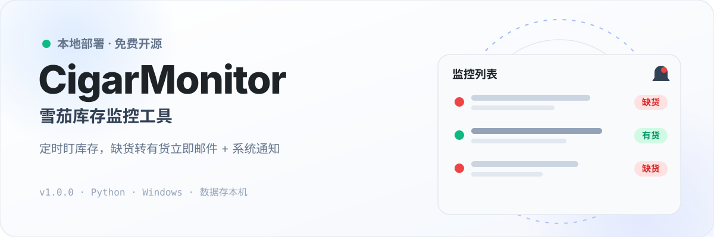
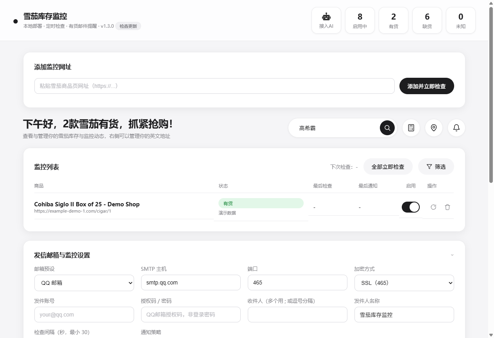
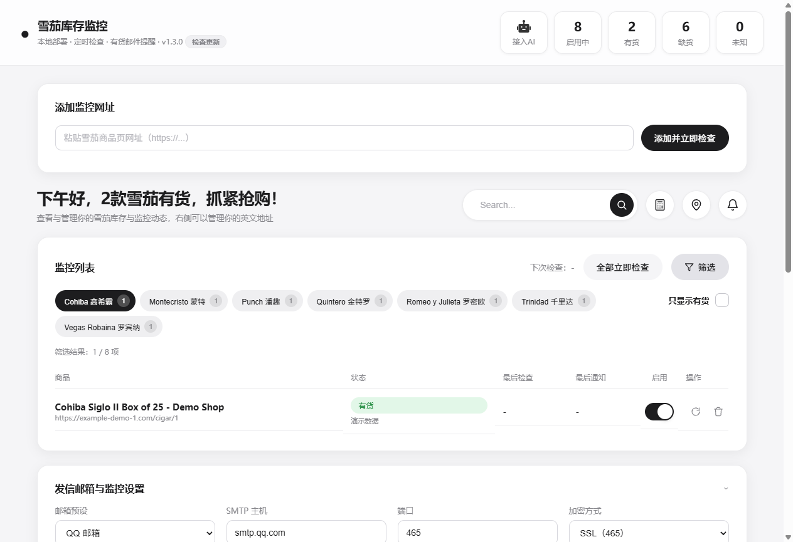

  

  
  
  
  
  

## 这是什么

CigarMonitor 是一个**本地部署的雪茄库存监控工具，同时是一个标准 MCP server**：把商品页网址丢进去，它会在后台定时检查库存，一旦从「缺货」变成「有货」，立即通过邮件、Windows 系统通知、微信三通道提醒，并在邮件里直接算好人民币到手总价与单支价。

软件本身**不内置、不打包任何大模型**，而是通过标准 MCP（Model Context Protocol）端点把全部能力开放给本机已安装的 AI 助手——你可以让 Claude、豆包、WorkBuddy、千问等用语音或文字直接查询库存、添加监控、计算到手价。全部数据保存在自己电脑上，无需公网服务器，也不向第三方上传数据。

提供桌面应用（推荐）与浏览器版两种使用方式。

## 界面预览

<table>
  <tr>
    <td width="33%">
      
    </td>
    <td width="33%">
      
    </td>
    <td width="33%">
      
    </td>
  </tr>
  <tr>
    <td align="center"><b>监控总览</b></td>
    <td align="center"><b>中文搜索</b></td>
    <td align="center"><b>品牌筛选</b></td>
  </tr>
</table>

查看「监控总览」大图

查看「中文搜索」大图

查看「品牌筛选」大图

## 功能特性

- **标准 MCP server**：内置 `/mcp` 端点，开放 8 个工具——软件状态、库存查询、添加监控、立即检查、启用/停用、删除监控、到手价计算、收货地址管理；不绑定任何厂商，任意支持 MCP 的 AI 都能接入
- **「接入 AI」管理**：弹窗自动扫描本机已安装的 AI 助手（进程发现 + 多路径探测），支持一键写入 MCP 配置，可同时接入多个；不支持自动写入的助手提供分步手动接入引导与可复制提示词
- **定时巡检**：添加网址即自动识别商品名并完成首次检查，默认每 5 分钟轮询（界面可调，最小 30 秒）；站点级 429 自动按 5→10→20 分钟退避
- **三通道有货提醒**：仅在「缺货 → 有货」时触发，不重复刷屏——HTML 邮件、Windows 系统通知、微信 ClawBot 同时送达
- **品牌中文化**：内置 34 个雪茄品牌的中英文词库，简称、全称都认；软件首页单款有货显示纯中文简称，邮件/系统通知/微信统一显示「英文（中文简称）」，无中文译名则只显示英文
- **邮件到手价**：自动抓取商品货币、总价与一盒支数，按到手计算器同款公式给出商品原价、人民币货值、预估税费、**到手总价、到手单价**；计税价超 ¥2,000 提示寄递限值/退运风险，税额 ≤¥50 提示可能免征
- **到手计算器**：支持 8 种货币，海关计征汇率取中国货币网官方中间价（每月更新）、实时市场汇率自动获取并本地缓存，按 50% 烟草综合税率计算，断网可回退缓存
- **本地优先**：数据存本机 SQLite，关闭窗口即缩到托盘继续运行，不依赖公网服务器
- **自动更新**：后台检测新版本，一键下载整包并镜像替换、自动重启；用户数据独立存放，更新不丢失
- **多邮箱预设**：QQ、163、126、Gmail、Outlook，另支持自定义 SMTP

## 工作原理

  

未知站点会先读取页面结构化数据（JSON-LD），再用多语言关键词（in stock / add to cart / ausverkauft / rupture de stock 等）兜底判断；带 Cloudflare 防护的站点自动切换浏览器指纹抓取。价格同样优先读取 JSON-LD，再以 `meta itemprop` 标记兜底，支数从商品名（box of N / pack of N / N sticks）识别。

## 快速开始

### 桌面版（推荐）

1. 到 [Releases](https://github.com/hoho77777/cigar-monitor/releases) 下载安装包 `CigarMonitor_v1.3.0_setup.exe` 双击安装；也可下载免安装的 `CigarMonitor_v1.3.0_windows.zip` 解压使用，整包包含 `CigarMonitor.exe` 与 `_internal`，两者必须放在一起，不要只移动 exe
2. 双击 `CigarMonitor.exe`，稍候弹出原生窗口
3. 在「发信邮箱与监控设置」填入邮箱账号和 **SMTP 授权码**，保存后可点「发送测试邮件」；如需微信推送，在下方扫码绑定 ClawBot
4. 顶部粘贴商品网址即可添加监控，列表默认空，由你自行添加
5. 点「接入 AI」卡片，可让本机 AI 助手一键接入并通过 MCP 操作本软件

**系统托盘行为**：点关闭按钮（×）不会退出，窗口隐藏并转入后台继续监控；点击托盘图标恢复窗口，右键可选择「显示主窗口」或「退出」，只有托盘菜单的「退出」才会真正结束程序。

> 桌面版依赖 Microsoft Edge WebView2 运行时，Windows 10/11 通常已预装；若窗口无法打开，可在微软官网免费安装「Microsoft Edge WebView2 Runtime」。

### 浏览器版

1. 双击 `start.bat`（首次运行自动安装依赖）
2. 浏览器打开 `http://127.0.0.1:5050`，在设置区填入邮箱与授权码
3. 关闭命令行窗口即停止监控；保持窗口开着即可持续运行

## 邮箱授权码获取

- **QQ 邮箱**：网页版「设置 → 账号」开启「IMAP/SMTP 服务」，按提示验证后获得 16 位授权码（非登录密码）
- **163 / 126 邮箱**：网页版「设置 → POP3/SMTP/IMAP」开启 SMTP 并获取客户端授权码
- **Gmail**：开启两步验证后使用「应用专用密码」
- 选择对应预设后，SMTP 主机、端口、加密方式会自动填充，一般无需手动修改

## 从源码构建

仓库不包含二进制文件（图标、exe、数据库均通过 `.gitignore` 排除）。

1. 安装依赖：`pip install -r requirements.txt`
2. 生成图标：`python make_icons.py`（有源图则从源图生成，无源图自动绘制「深色圆角底 + 金雪茄」默认图标）
3. 打包：直接运行 `build.bat`（缺图标时会先自动执行上一步），产物在 `dist\CigarMonitor\`

首次启动默认不预置任何监控项；如需预置，可在 `seed/products.json` 中加入条目（仓库内置为空列表）。

**开机自启**：按 `Win + R` 输入 `shell:startup`，把 `CigarMonitor.exe` 的快捷方式拖入启动文件夹即可后台静默运行。

## 数据与安全

- 浏览器版数据存于 `data\monitor.db`；桌面版存于 `%LOCALAPPDATA%\CigarMonitor\data\monitor.db`
- 邮箱授权码、ClawBot 凭证、收货地址仅保存在本机，不上传任何第三方
- 公开仓库只含源码、纯文本种子与合成演示截图，**不含任何邮箱、授权码、地址、真实监控数据、数据库、图标或 exe**；数据目录与构建产物已在 `.gitignore` 中全部排除
- 监控请求模拟普通浏览器访问，请合理设置检查频率，避免对目标站点造成压力

## 常见问题

- **测试邮件发不出去**：确认授权码正确、SMTP 服务已开启，主机/端口/加密保持对应预设
- **AI 助手扫描不出来**：弹窗会自动重新扫描进程与常见安装路径；确认助手已安装，仍不显示可使用下方手动接入，不影响使用
- **商品显示「未知」**：多为网络或反爬拦截，日志里有原因；Cloudflare 站点会自动重试，仍失败可降低检查频率
- **端口被占用**：桌面版会从 5050 起自动寻找可用端口，无需手动处理
- **自动更新**：仅在桌面打包版生效，整包镜像替换安装目录；数据库与设置位于 `%LOCALAPPDATA%` 独立目录，不会被改动，失败时静默跳过

## License

本项目基于 [MIT License](./LICENSE) 开源，可自由使用、修改与分发，请保留原始版权声明。
